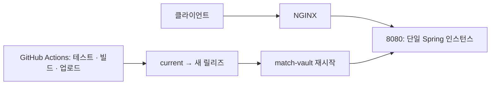
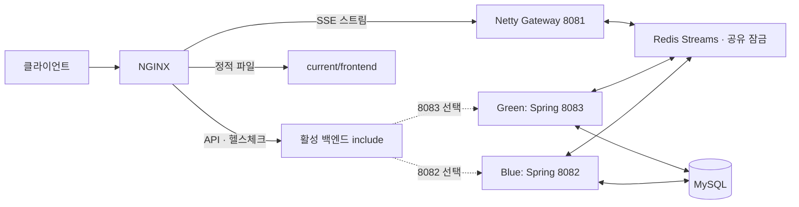
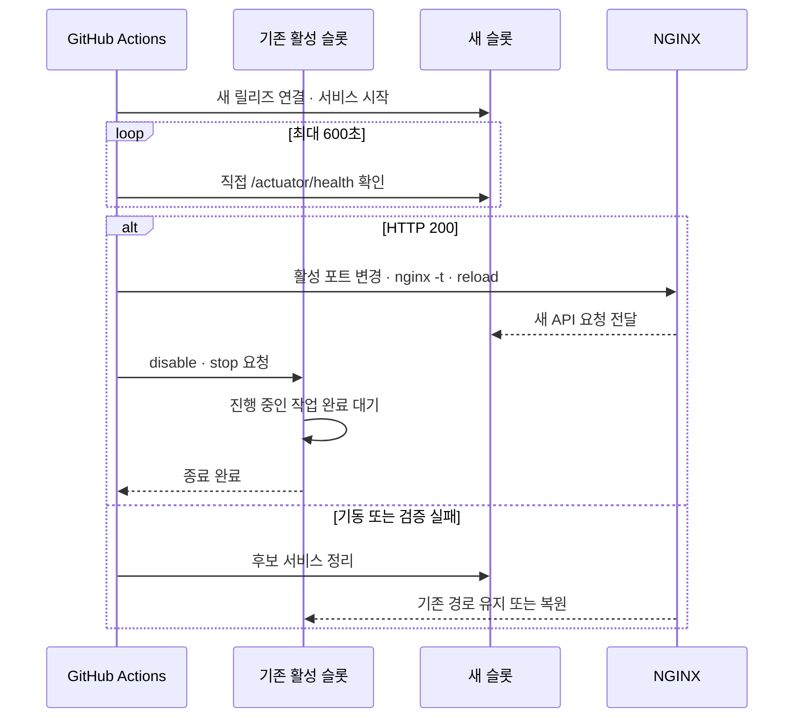
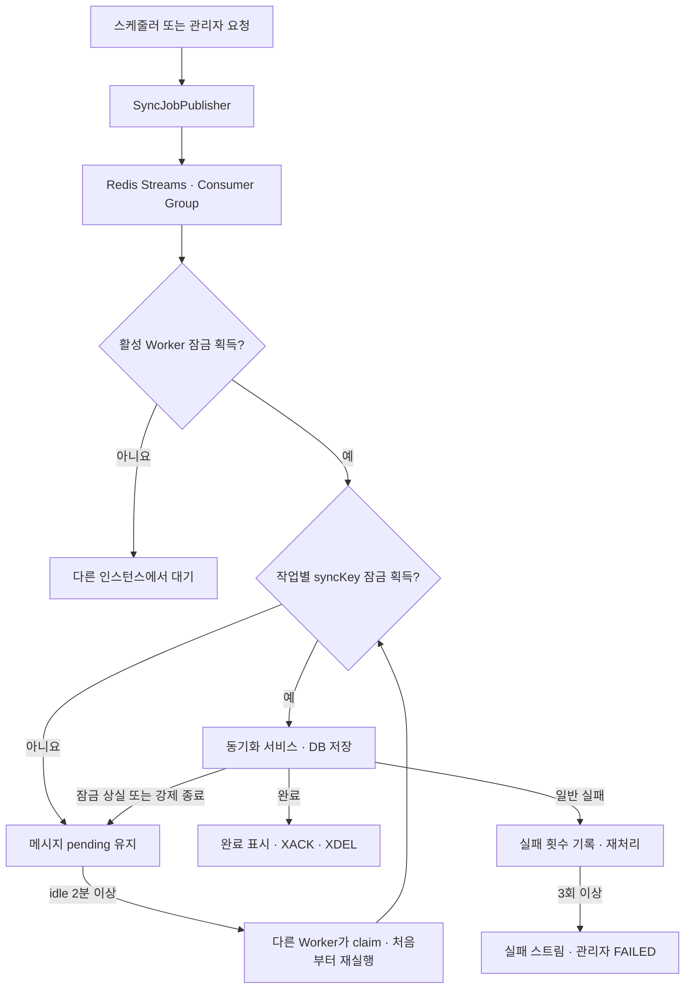

# Blue/Green 무중단 배포와 동기화 작업 처리

이 문서는 Match Vault의 기존 단일 인스턴스 배포에서 Blue/Green 배포로 변경한 이유와 현재 구현을 설명한다. 서버 설치 명령과 운영 점검 명령은 [운영 배포 안내](README.md)를 따른다.

## 기존 방식과 문제

기존 GitHub Actions는 백엔드 테스트와 프론트엔드·백엔드 빌드 후 릴리즈를 서버에 복사했다. 배포 스크립트는 `/opt/match-vault/current`를 새 릴리즈로 바꾸고 단일 `match-vault` 서비스를 `systemctl restart`했다. NGINX의 API 요청은 계속 `127.0.0.1:8080`으로 향했다.

재시작 중에는 새 애플리케이션이 기동하고 헬스체크를 통과할 때까지 API 요청을 처리할 인스턴스가 없다. 새 버전의 기동에 실패해도 `current`는 이미 새 릴리즈를 가리킨다. 또한 관리자 비동기 작업은 인스턴스 내부 실행기와 대기열을, 동기화 중복 방지 키는 인스턴스 메모리를 사용했다. 인스턴스가 종료되면 내부 대기 작업과 잠금 상태를 잃고, 두 인스턴스가 동시에 떠 있을 때도 서로의 잠금을 볼 수 없었다.

특히 경기 상세·선수·부상 동기화는 오래 걸릴 수 있다. 트래픽 전환만으로는 실행 중인 작업의 완료, 강제 종료 후 재실행, 중복 실행 방지를 보장할 수 없어서 배포 방식과 작업 처리 방식을 함께 변경했다.

## 현재 구조

| 영역 | 현재 방식 |
| --- | --- |
| API 트래픽 | NGINX가 활성 슬롯의 `8082`(Blue) 또는 `8083`(Green)으로 전달 |
| 프론트엔드 | NGINX가 `/opt/match-vault/current/frontend` 제공 |
| SSE 스트림 | 별도 Netty Gateway `8081`로 전달. Spring 슬롯 전환 대상에서 제외 |
| 동기화 대기열 | 두 Spring 인스턴스가 공유하는 Redis Streams |
| 동기화 실행 | Redis의 활성 Worker 잠금을 획득한 한 인스턴스가 소비 |
| 중복 방지 | 작업별 Redis 잠금과 예약 작업의 발행 중복 방지 키 |
| 관리자 진행 상태 | DB의 `AdminSyncJob`에 저장 |

NGINX의 활성 대상은 `/etc/nginx/match-vault-active-backend.conf`의 `server 127.0.0.1:<port>;` 한 줄로 정한다. 사이트 설정의 `/api/`와 `/actuator/health`가 이 upstream을 사용한다. Blue와 Green은 동일한 운영 환경 파일을 읽되, systemd unit에서 각각 포트 `8082`, `8083`을 지정한다. 관련 설정 예시는 [NGINX](nginx/match-vault.conf.example), [Blue unit](systemd/match-vault-blue.service.example), [Green unit](systemd/match-vault-green.service.example)에 있다.

활성 Worker 잠금은 **Redis 큐의 소비자**를 한 인스턴스로 제한한다. 관리자 즉시 실행과 별도의 실패 재시도 경로는 큐 밖에서 실행될 수 있으므로 모든 동기화 호출을 전역으로 직렬화하는 장치는 아니다. 이런 경로와 같은 종류의 작업이 겹치지 않도록 작업별 `syncKey` 잠금도 유지한다.

## 배포 처리 순서

[배포 워크플로](../.github/workflows/deploy.yml)는 `main` 푸시 또는 수동 실행으로 시작한다. 백엔드 테스트·JAR 빌드와 프론트엔드 빌드를 마친 뒤, Linux [배포 모의 검증](scripts/test-deploy-production.sh)을 통과해야 운영 배포를 진행한다. 산출물은 커밋 SHA를 이름으로 하는 릴리즈 묶음으로 서버에 업로드한다.

[운영 배포 스크립트](scripts/deploy-production.sh)는 다음 순서로 실행한다.

1. `flock`으로 동시 배포를 막고, 활성 백엔드 파일을 읽어 비활성 슬롯을 선택한다. 초기 `8080`에서 첫 배포는 Blue, 이후에는 Blue와 Green을 번갈아 선택한다.
2. 업로드된 묶음을 `/opt/match-vault/releases/<SHA>`에 풀고 백엔드 JAR와 프론트엔드 파일을 확인한다. 비활성 슬롯의 symlink를 해당 릴리즈로 바꾼다.
3. 비활성 systemd 서비스를 시작하고 그 포트의 `/actuator/health`가 HTTP 200이 될 때까지 최대 600초 기다린다. 이때 기존 슬롯은 계속 요청을 받는다.
4. NGINX 설정을 검사하고 활성 백엔드 파일을 새 포트로 바꾼 뒤 다시 검사·reload한다. 이어서 `current` 프론트엔드 symlink를 새 릴리즈로 옮기고 새 서비스를 활성화한다.
5. 이전 서비스를 `disable`하고 `systemctl stop`이 끝날 때까지 기다린다. 진행 중인 동기화 작업이 있다면 정상 종료 절차에서 완료를 기다린다.

전환 전 오류에는 EXIT 처리로 기존 NGINX 대상, 프론트엔드 `current`, 비활성 슬롯 링크를 복원한다. 전환이 확정된 뒤 이전 서비스 종료에 실패하면 이미 전환된 트래픽을 되돌리지 않고 배포 작업을 실패로 보고한다. 따라서 Actions 성공은 이전 서비스 종료까지 완료됐다는 뜻이다. 릴리즈 디렉터리는 실패 시에도 남겨 조사할 수 있다.

## 동기화 작업 처리 순서

시즌 경기 상세 세대 정리 기능을 배포할 때는 새 애플리케이션을 켜기 전에 기존 DB에
[`sql/fixture-detail-generation-cleanup.sql`](../sql/fixture-detail-generation-cleanup.sql)을 한 번 적용한다.
이 SQL은 공개 작업 영수증의 세대 외래 키만 제거한다. 영수증 행은 남아 있어 늦게 재전달된
Redis 작업의 중복 공개를 방지한다. SQL이 빠지면 정리 트랜잭션은 외래 키 오류로 롤백된다.

세대 정리 스케줄러는 세대 조회·배치·정리 설정이 모두 켜져 있을 때 매일 02:30(Asia/Seoul)에
실행한다. 실패 세대는 7일 뒤, 이전 공개 세대는 최근 2개를 남기고 교체된 지 7일이 지난 뒤
삭제한다. 한 번에 최대 5개 세대를 각각 별도 트랜잭션으로 정리하고 현재 공개 세대는 제외한다.
실행 시각과 보관 정책은 `FIXTURE_DETAIL_GENERATION_CLEANUP_*` 설정으로 조정할 수 있으며,
7일·2개보다 작은 값은 적용하지 않는다.

### 발행

- 스케줄러와 시작 시 동기화 Runner는 Redis 큐가 켜져 있을 때 작업을 직접 실행하지 않고 [SyncJobPublisher](../src/main/java/com/son/soccerStreaming/apifootball/service/SyncJobPublisher.java)에 전달한다. `task`, `syncKey`, `league`·`season` 인자를 담은 [SyncQueueMessage](../src/main/java/com/son/soccerStreaming/apifootball/service/SyncQueueMessage.java)와 [SyncJobPayload](../src/main/java/com/son/soccerStreaming/apifootball/service/SyncJobPayload.java)를 사용한다. 예약 작업 ID에는 시간 단위를 잘라 만든 실행 시각을 포함한다.
- 관리자 작업 중 **시즌 경기 상세 일괄·선수·부상 동기화**만 [AdminService](../src/main/java/com/son/soccerStreaming/admin/service/AdminService.java)의 `queueSync`를 거친다. 먼저 DB에 `QUEUED` 작업과 재발행용 payload를 저장한 뒤 Redis에 발행한다. Redis 발행에 실패해도 DB 작업을 남기고 Worker가 재발행한다. 시즌·팀·순위·경기 등의 짧은 관리자 즉시 실행 작업은 현재 직접 호출 경로를 유지한다.
- [RedisSyncJobStream](../src/main/java/com/son/soccerStreaming/apifootball/service/RedisSyncJobStream.java)의 Lua 스크립트가 `XADD`와 중복 방지 키 설정을 한 번의 Redis 연산으로 묶는다. 두 인스턴스의 같은 예약 시각 발행과 활성 `syncKey`의 중복 등록을 막는다.

### 소비와 완료

[RedisSyncJobWorker](../src/main/java/com/son/soccerStreaming/apifootball/service/RedisSyncJobWorker.java)는 시작 시 Consumer Group을 준비하고, Redis의 `redis-sync-worker:active` 잠금을 획득한 인스턴스만 소비한다. 다른 인스턴스의 Worker는 잠금이 풀릴 때까지 재시도한다. 활성 Worker는 새 메시지를 한 번에 하나씩 읽고, 새 메시지가 없으면 일정 시간 이상 pending인 메시지를 확인한다.

작업을 가져오면 작업별 `syncKey` 잠금을 획득하고 payload에 맞는 동기화 서비스를 호출한다. 관리자 작업은 [AdminSyncTaskRunner](../src/main/java/com/son/soccerStreaming/admin/service/AdminSyncTaskRunner.java)가 DB 진행 상태와 감사 로그를 기록한다. 동기화 서비스가 결과를 DB에 저장하고 작업이 끝나면 Worker가 완료 표시를 기록한 뒤 `XACK` 및 `XDEL`로 메시지를 정리한다. Redis와 MySQL에 걸친 단일 원자적 트랜잭션은 아니므로, 강제 종료 시 작업의 일부 DB 쓰기가 끝난 상태에서 처음부터 재실행될 수 있다.

관리자 `QUEUED`/`RUNNING` 작업은 [AdminSyncJobService](../src/main/java/com/son/soccerStreaming/admin/service/AdminSyncJobService.java)가 재시작 시 곧바로 `FAILED`로 바꾸지 않는다. Worker는 시작 시와 기본 60초 주기로 DB에서 복구 가능한 작업을 찾아 Redis에 다시 발행한다. 이 재발행은 작업 ID 기반 중복 방지와 함께 동작한다. 일반 실행 오류는 메시지별 실패 횟수를 기록하고 재처리하며, 3회 이상 실패하면 실패 스트림으로 이동한다. 잠금 상실은 일반 실패 횟수에 넣지 않고 pending으로 남겨 재획득하게 한다.

### 잠금과 Lease

[SyncLockStore](../src/main/java/com/son/soccerStreaming/apifootball/service/SyncLockStore.java)는 획득·갱신·해제를 정의한다. 운영에서는 [RedisSyncLockStore](../src/main/java/com/son/soccerStreaming/apifootball/service/RedisSyncLockStore.java)가 `SET NX`와 TTL로 잠금을 얻고, Lua 스크립트에서 소유자 ID가 같을 때만 갱신하거나 해제한다. Redis 잠금이 꺼진 환경은 [InMemorySyncLockStore](../src/main/java/com/son/soccerStreaming/apifootball/service/InMemorySyncLockStore.java)를 사용한다. Redis 큐를 켰는데 공유 잠금을 끄면 시작 시 오류를 내도록 했다.

[ApiFootballSyncExecutionGuard](../src/main/java/com/son/soccerStreaming/apifootball/service/ApiFootballSyncExecutionGuard.java)의 `Lease`는 해당 인스턴스가 가진 잠금 키·소유자 ID·유효 상태다. `localLeases`는 그 인스턴스에서 갱신할 Lease 목록을 관리한다. 갱신 스레드는 20초마다 2분 TTL을 연장한다. Redis 통신 오류나 소유권 상실로 갱신하지 못하면 Lease를 무효화한다. Worker와 동기화 서비스는 작업 단위 경계에서 `checkCurrentLease()`를 호출해 [SyncLockLostException](../src/main/java/com/son/soccerStreaming/apifootball/service/SyncLockLostException.java)으로 실행을 멈춘다. 관리자 진행 보고의 취소 확인도 이 검사를 포함한다.

이 검사는 잠금 상실을 다음 확인 지점에서 감지한다. 확인 직후의 DB 쓰기를 원자적으로 차단하는 *fencing token*은 구현하지 않았다. 따라서 재실행을 허용하는 현재 동기화 작업의 성질에 의존하며, 엄격한 단일 쓰기 보장이 필요한 작업에는 추가 설계가 필요하다.

## 종료, 강제 중단, SSE

새 슬롯으로 트래픽을 옮긴 뒤 이전 슬롯에는 정상 종료 신호를 보낸다. [RedisSyncJobWorker](../src/main/java/com/son/soccerStreaming/apifootball/service/RedisSyncJobWorker.java)는 새 작업 수락을 멈추고 현재 작업 스레드가 끝나기를 최대 30분 기다린다. Spring 종료 단계는 31분, [systemd unit](systemd/match-vault-blue.service.example)은 `TimeoutStopSec=32min`으로 설정해 Redis 연결이 작업보다 먼저 닫히지 않도록 한다. 작업이 끝나면 완료 표시와 ACK 후 서비스가 종료된다.

프로세스가 강제로 종료되면 Redis Streams 메시지는 ACK되지 않아 Consumer Group의 pending 상태로 남는다. 기존 잠금은 갱신이 멈추므로 TTL이 끝나고, 다른 인스턴스가 Worker 잠금을 얻은 뒤 idle 2분 이상인 메시지를 claim해 처음부터 처리한다. 이 경로의 정확한 실행 시점은 잠금 만료, 새 Worker의 반복 확인 시각, Redis 상태에 따라 달라진다.

SSE 스트림 경로는 Spring 슬롯이 아니라 기존 Netty Gateway(`8081`)로 전달한다. Spring 애플리케이션이 발급하는 브라우저 신원을 Gateway가 검증하므로 두 서비스에는 **같은 `SSE_IDENTITY_SECRET`(최소 32바이트)**이 필요하다. 값은 문서나 로그에 기록하지 않는다. 실제 첫 배포에서는 MVC 환경 파일에 이 항목이 없어 Blue 기동이 실패했고, Gateway와 동일한 값을 설정한 뒤 배포가 성공했다.

## 검증 결과와 범위

- 백엔드 `test`·`bootJar`, 프론트엔드 `npm run build` 통과.
- Linux 모의 검증에서 후보 헬스체크 실패 시 기존 경로 유지, NGINX reload 실패 시 복구, Blue→Green 순환 확인.
- 운영 서버에서 같은 릴리즈로 첫 Blue 배포와 다음 Green 배포가 모두 성공했다. Green 전환 뒤 Blue 서비스 종료까지 GitHub Actions 로그에서 확인했다.
- 정상 종료 중 실행하던 장시간 동기화 작업의 운영 서버 실험과 강제 종료 후 pending 재획득은 별도 시나리오다. 현재 성공 기록은 슬롯 전환과 종료 절차가 완료됐다는 근거이며, 모든 장애 복구 경로의 운영 검증을 뜻하지 않는다.

헬스체크는 새 슬롯의 `/actuator/health` 응답을 직접 확인한다. 배포 후에는 NGINX를 통한 공개 API와 프론트엔드도 [운영 배포 안내](README.md#배포-후-검증)에 따라 확인한다. API 경로 전환과 `current` 프론트엔드 symlink 변경은 별도 작업이므로 두 변경을 하나의 원자적 동작으로 보장하지는 않는다.
